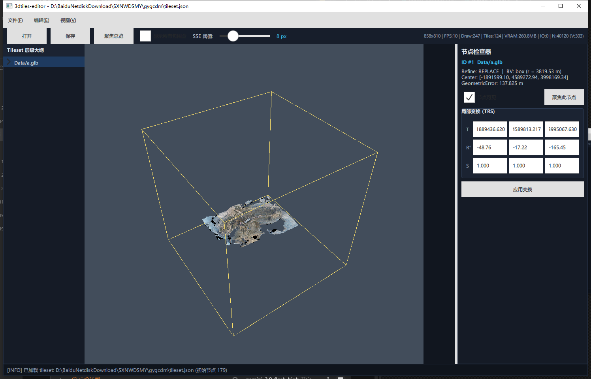

# 3D Tiles Editor

跨平台桌面端 3D Tiles 倾斜摄影与三维地质模型编辑器，基于 **Qt 6 (Quick / QML) + Rust + WebGPU (`wgpu`)** 深度混合架构。

> 📖 **详细使用手册与平台实操指南**：完整包含 Windows、macOS 编译运行、三维漫游手势、TRS 空间编辑与排障，详见 **[用户实操手册 (docs/USER_MANUAL.md)](docs/USER_MANUAL.md)**。



---

## 核心特性

- **现代 GUI 架构（Qt 6 + QML）**：
  - 采用分区 Dock 布局设计，具备顶部工具栏、左侧场景大纲树、中央 3D 视口、右侧属性检查器（Inspector）、底部实时日志与统计状态栏。
  - 基于 `ViewportItem` 与 `QWindow` 实现无边框子窗口嵌入，设置 `QSurface::VulkanSurface`，利用 Win32 `WS_CLIPCHILDREN`/`WS_CLIPSIBLINGS` 拦截消解 GDI 穿透白屏闪烁。
- **高精度 WebGPU (`wgpu`) 渲染核**：
  - 原生 Vulkan / D3D12 多适配器枚举与探测，优先绑定独立显卡硬件交换链。
  - **Reversed-Z 深度缓冲**：极大提升远景和地平线渲染深度精度，杜绝远近裁切面 Z-fighting。
  - **RTE (Relative-to-Eye, `f64 -> f32`) 动态平移**：彻底解决双精度大尺度地理坐标在 GPU 单精度运算下的网格抖动。
  - **动态光照与法线自愈**：针对正射航拍无显式法线的网格，利用 WGSL 着色器 `dpdx/dpdy` 屏幕空间偏导实时重构几何法线。
- **海量切片异步调度与 LOD 视锥裁剪**：
  - Tokio 多线程异步加载池，支持根 `tileset.json` 与外部子级 `tileset.json` 异步非阻塞展开与层级合并。
  - SSE (Screen Space Error) / 视锥体视见剔除驱动，空壳瓦片（80 字节祖先瓦片）即时就绪，有效降低 GPU 开销。
  - LRU 显存缓存与自动垃圾回收机制。
- **双层空间拾取与属性检查**：
  - 空间粗筛：包围体 OBB (Oriented Bounding Box) / 空间包围球相交求交。
  - 几何精筛：Möller-Trumbore 射线-三角形相交测试。
  - 检查器右侧实时显示瓦片 URI、Geometric Error、Refine、Bounding Volume、空间变换矩阵（Transform 4x4）、面片/顶点统计与纹理状态。
- **无损编辑与控制栈**：
  - 节点平移、旋转、缩放（TRS）交互。
  - 节点显隐切换（写入规范拓展 `extras.3dtiles_editor.hidden`）。
  - 事务化 Command 撤销/重做栈（Undo/Redo）。
  - 保持 JSON 结构与字段格式的无损保存（Save / Save As）。

---

## 模块架构

```text
3dtiles-editor/
├── crates/
│   ├── tiles_core/       # 3D Tiles 1.1/1.0 规范解析、GLB/B3DM/CMPT 解包、变换矩阵与空间拾取
│   ├── tiles_io/         # 异步 Tokio 文件/切片调度池、外部子 Tileset 递归合并、LOD 视锥裁剪
│   ├── tiles_render/     # wgpu 渲染器、Reversed-Z 渲染管线、RTE 相机着色器与顶点/纹理缓冲管理
│   ├── tiles_app/        # 编辑器会话控制器、TRS/显隐命令栈、Undo/Redo 与事件循环
│   └── tiles_ffi/        # 导出 C ABI 接口（include/tiles_ffi.h）供 Qt 绑定调用
├── qt_ui/                # Qt 6 QML / C++ 界面层
│   ├── include/          # EngineBridge, ViewportItem, TileTreeModel
│   ├── src/              # Qt 窗口生命周期、鼠标手势漫游、Win32 消息钩子
│   └── qml/              # Main.qml 及现代化深色工程主题 UI 组件
├── docs/screenshots/     # 实机运行效果与测试截图
├── scripts/              # 自动化测试与硬件抓帧验收脚本
├── CMakeLists.txt        # 顶层 CMake 构建配置（集成 Corrosion 桥接 Rust）
└── Cargo.toml            # Rust 顶层 Workspace 配置
```

---

## 真机测试与实测表现

在典型倾斜摄影无人机实测数据集 `gygcdm`（40,244 个文件，含 124 个外部 tileset）上进行了完整验证：

| 指标 | 实测表现 |
| :--- | :--- |
| **场景树解析** | **40,120** 个节点异步秒级索引合并 |
| **GPU 设备绑定** | NVIDIA GeForce GTX 1650 (Vulkan) |
| **实时帧率** | 稳定 **62 FPS** |
| **显存占用 (VRAM)** | **48.3 MB** |
| **有效绘制批次 (Draw Calls)** | **124** 个叶子纹理切片 |

---

## 构建与运行

### 1. 环境准备
- **Rust 工具链**：`rustc >= 1.80`, `cargo`
- **C++ 编译器**：支持 C++20 的 MSVC 或 MinGW (GCC 13+)
- **CMake**：`>= 3.24`
- **Ninja**：推荐
- **Qt 6 SDK**：`>= 6.6`（包含 `Core`, `Gui`, `Quick`, `QuickControls2`, `Widgets`）

### 2. 执行 Rust 单元测试与冒烟测试
```bash
cargo test --workspace
```

### 3. 使用 CMake 编译应用程序
```bash
cmake -B build -G "Ninja" -DCMAKE_BUILD_TYPE=Release -DCMAKE_PREFIX_PATH="<QT_INSTALL_PREFIX>"
cmake --build build --config Release
```

### 4. 运行编辑器并加载 3D Tiles 数据集
```bash
./build/3dtiles-editor.exe "path/to/tileset.json"
```

---

## 快捷键与视口操作

- **鼠标左键拖拽**：围绕视锥中心局部轨道旋转（Orbit）。
- **鼠标右键 / 中键拖拽**：相机屏幕空间平移（Pan）。
- **鼠标滚轮**：定点缩放（Zoom）。
- **鼠标左键点击**：空间拾取瓦片，右侧 Inspector 联动显示属性与几何结构。
- **Ctrl + Z**：撤销上一步操作。
- **Ctrl + Y**：重做上一步操作。
- **Ctrl + S**：无损保存修改至当前 `tileset.json`。
