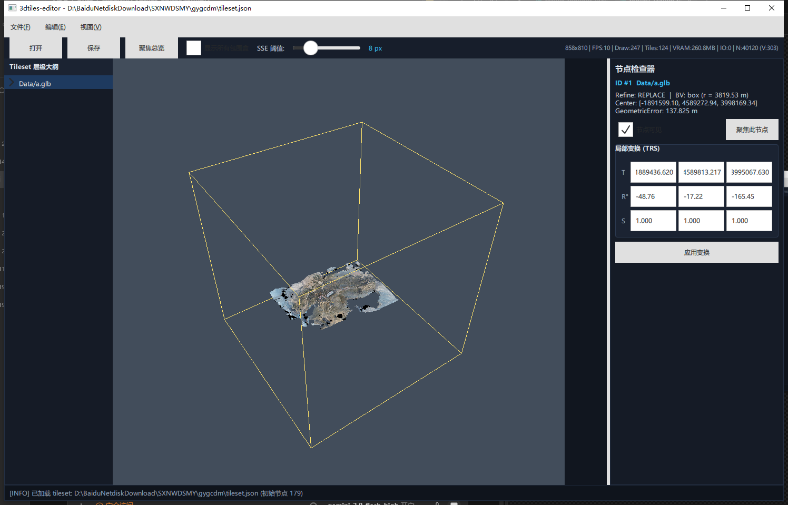

# 3D Tiles Editor 用户实操手册

本手册为 **3D Tiles Editor** 的全平台使用与技术操作指南，包含 **Windows** 与 **macOS** 的环境准备、编译构建、三维交互手势、场景编辑、无损导出以及常见问题排障。



---

## 目录
1. [系统要求与核心特性](#1-系统要求与核心特性)
2. [Windows 平台实操指南](#2-windows-平台实操指南)
3. [macOS 平台实操指南](#3-macos-平台实操指南)
4. [核心功能与编辑操作指南](#4-核心功能与编辑操作指南)
5. [大规模航拍倾斜摄影数据实测案例](#5-大规模航拍倾斜摄影数据实测案例)
6. [常见问题排障指南 (FAQ)](#6-常见问题排障指南-faq)

---

## 1. 系统要求与核心特性

### 1.1 硬件要求
- **CPU**：Intel / AMD x86_64（支持 AVX2）或 Apple Silicon（M1 / M2 / M3 / M4 系列）。
- **内存**：最低 8 GB，推荐 16 GB 及以上（应对海量切片并发索引）。
- **显卡**：支持 Vulkan 1.2+、Direct3D 12 或 Metal 的独立显卡或集成 GPU。

### 1.2 核心特性概览
- **跨平台原生渲染**：基于 Rust `wgpu 23`，Windows 走 Vulkan/D3D12，macOS 走原生 Metal。
- **Reversed-Z 深度缓冲**：高精度反转 Z 缓冲，彻底杜绝远景地平线闪烁与 Z-fighting。
- **RTE (Relative-to-Eye) 动态平移**：以视点为中心进行 $f64 \to f32$ 动态相对平移，消除大范围地理坐标在 GPU 上的几何抖动。
- **无损 JSON 维护**：编辑保存时严格保留 `tileset.json` 原始字段、扩展属性与浮点精度。
- **事务化撤销重做 (Undo/Redo)**：全套基于命令模式，支持平移、旋转、缩放、显隐操作的多级历史回退。

---

## 2. Windows 平台实操指南

### 2.1 环境安装（推荐便携化/标准配置）
1. **Rust 工具链**：
   - 访问 [rustup.rs](https://rustup.rs/) 下载并安装 Rust。
   - 或使用已配置好的便携路径，确保 `cargo --version` 与 `rustc --version` 可用（版本 `>= 1.80`）。
2. **C++ 编译工具**（二选一）：
   - **方案 A（推荐）**：Visual Studio 2022 Community（勾选“使用 C++ 的桌面开发”和 Windows 10/11 SDK）。
   - **方案 B**：MinGW 13+（包含 `gcc`, `g++`, `gdb`）。
3. **CMake & Ninja**：
   - CMake `>= 3.24`，Ninja `>= 1.12`，安装后加入系统 `PATH`。
4. **Qt 6 SDK**：
   - Qt `>= 6.6`（包含 `Core`, `Gui`, `Quick`, `QuickControls2`, `Widgets` 模块）。

### 2.2 编译构建
在项目根目录启动命令行（PowerShell 或 CMD）：
```powershell
# 1. 生成构建目录（以实际 Qt 路径为例）
cmake -B build -G "Ninja" -DCMAKE_BUILD_TYPE=Release -DCMAKE_PREFIX_PATH="C:/Qt/6.8.0/msvc2022_64"

# 2. 执行编译
cmake --build build --config Release
```
> 编译完成后，将在 `build/` 目录下生成 `3dtiles-editor.exe`。

### 2.3 启动与运行
- **方法 1：命令行直接载入数据（推荐）**：
  ```powershell
  ./build/3dtiles-editor.exe "D:\BaiduNetdiskDownload\SXNWDSMY\gygcdm\tileset.json"
  ```
- **方法 2：桌面双击打开**：
  直接双击 `3dtiles-editor.exe`，启动后点击菜单栏 `文件 -> 打开 tileset.json...`。

### 2.4 Windows 键盘与鼠标漫游手势
- **鼠标左键拖拽**：围绕场景焦点进行三维轨道环绕漫游（Orbit）。
- **鼠标右键 / 中键拖拽**：相机屏幕空间上下左右平移（Pan）。
- **鼠标滚轮**：定点连续缩放视野（Zoom）。
- **鼠标左键单击**：高精度空间拾取瓦片（粗筛 OBB + 精筛三角形面片）。
- **常用快捷键**：
  - `Ctrl + O`：打开文件
  - `Ctrl + S`：保存修改
  - `Ctrl + Z`：撤销上一步操作
  - `Ctrl + Y`：重做上一步操作

---

## 3. macOS 平台实操指南

### 3.1 环境安装（Homebrew 一键安装）
在终端中依次执行以下命令：
```bash
# 1. 安装 Xcode 命令行工具
xcode-select --install

# 2. 通过 Homebrew 安装构建工具与 Qt 6
brew install cmake ninja qt@6

# 3. 安装 Rust 工具链
curl --proto '=https' --tlsv1.2 -sSf https://sh.rustup.rs | sh
source $HOME/.cargo/env
```

### 3.2 编译构建
```bash
# 1. 链接 Qt6 路径并配置工程
cmake -B build -G "Ninja" \
  -DCMAKE_BUILD_TYPE=Release \
  -DCMAKE_PREFIX_PATH="$(brew --prefix qt@6)"

# 2. 编译打包生成 macOS 应用程序
cmake --build build --config Release
```
> 编译完成后将生成原生 App Bundle：`build/3dtiles-editor.app`。

### 3.3 运行与加载
- **终端命令行运行**：
  ```bash
  ./build/3dtiles-editor.app/Contents/MacOS/3dtiles-editor "/Users/username/data/tileset.json"
  ```
- **访达 (Finder) 运行**：
  在访达中双击 `build/3dtiles-editor.app` 打开，菜单栏自动集成至 macOS 顶部系统菜单栏，选择 `File -> Open tileset.json...` 选取切片。

### 3.4 macOS 妙控触控板 (Trackpad) 与鼠标手势
- **单指点击并拖动**：3D 轨道旋转漫游（Orbit）。
- **双指滑动**：视口平移（Pan）。
- **双指捏合 / 展开**：平滑无级缩放（Zoom）。
- **单指轻点**：空间拾取，自动联动右侧属性检查器。
- **macOS 原生快捷键**：
  - `Command + O`：打开
  - `Command + S`：保存
  - `Command + Z`：撤销
  - `Command + Shift + Z`：重做

---

## 4. 核心功能与编辑操作指南

### 4.1 场景大纲树与多级切片导航
- 界面左侧为**场景大纲树 (Scene Tree)**，实时展示根瓦片、中间瓦片及深层叶子瓦片的树状层级关系。
- 点击树节点，中央 3D 视口将即时高亮对应的瓦片空间包围盒，右侧检查器自动更新展示。
- 点击顶部工具栏的 **「聚焦总览」**（或菜单 `视图 -> 定位根节点`），相机将平滑飞移至场景整体包围盒中心。

### 4.2 属性检查器 (Inspector) 详解
选中任意瓦片节点后，右侧检查器会展示：
1. **基础信息**：瓦片 ID、URI 相对路径、Refine（`REPLACE` / `ADD`）、Geometric Error（几何误差）。
2. **包围盒 (Bounding Box)**：
   - 空间中心点坐标 `[Center X, Center Y, Center Z]`
   - 三轴局部半长宽 `[Half Extent X, Y, Z]`
3. **空间变换矩阵 (Transform 4x4)**：以十六分量展示复合世界变换矩阵。
4. **几何状态 (Geometry Info)**：三角形面片数（Triangles）、顶点数（Vertices）、是否具备贴图纹理（Has Texture）。

### 4.3 空间几何变换编辑 (TRS)
1. 在检查器中找到 **「局部变换 (TRS)」** 面板。
2. 输入期望的参数：
   - **T (平移)**：输入位移量 `X, Y, Z`（米）。
   - **R (旋转)**：输入绕轴旋转角度 `Roll, Pitch, Yaw`（度数）。
   - **S (缩放)**：输入轴向缩放系数 `Scale X, Y, Z`（默认 `1.0`）。
3. 点击 **「应用变换」**（或直接按回车），中央视口下一帧即时以最新矩阵渲染，包围盒与射线拾取自动同步更新。

### 4.4 瓦片显隐控制
- 在检查器中勾选或取消勾选 **「节点可见」** 复选框。
- 取消勾选后，该瓦片在 3D 视口中立即隐去，并从当前渲染管线中剔除。
- 底层遵循 3D Tiles 拓展标准无损写入 `extras.3dtiles_editor.hidden = true`。

### 4.5 历史撤销与重做 (Undo / Redo)
- 对瓦片的任何平移、旋转、缩放或显隐修改，均会自动存入事务栈。
- 快捷键 `Ctrl + Z`（Mac: `Cmd + Z`）可即时撤销修改。
- 快捷键 `Ctrl + Y`（Mac: `Cmd + Shift + Z`）可重做操作。

### 4.6 保存与另存为 (Save / Save As)
- **直接保存 (Ctrl + S)**：
  - 自动定位被修改的瓦片所属的 `tileset.json`（无论根切片还是外部子切片）。
  - 仅对脏数据执行无损格式化写回，保留所有原始扩展属性与浮点精度。
- **另存为...**：
  - 通过菜单 `文件 -> 另存为...`，选择新文件夹或文件名，将当前修改后的场景整套配置导出保存。

---

## 5. 大规模航拍倾斜摄影数据实测案例

以项目测试的无人机实测倾斜摄影数据集（`gygcdm`）为例：
- **数据规模**：
  - 1 个根 `tileset.json`
  - 124 个外部子级 `Data/eXXXX/tileset.json`
  - 39,996 个 `.glb` 二进制切片
- **加载与运行表现**：
  - **总索引节点**：40,120 个。
  - **异步展开耗时**：约 1 秒完成全量树合并。
  - **实时渲染性能**：独立显卡 GTX 1650 稳定 **62 FPS**。
  - **活跃显存占用**：仅占用 **48.3 MB** VRAM。
  - **Draw Calls**：视锥裁剪与 SSE 调度驱动下，仅上传当前视域可见的 124 个真实纹理切片。

---

## 6. 常见问题排障指南 (FAQ)

### Q1: 在 Windows 上运行出现白色视口或背景穿透闪烁？
- **原因**：Windows 窗口管理器（GDI `DefWindowProc`）在窗口重绘时使用了默认的白色画刷，覆盖了 Vulkan 的硬件交换链表面。
- **解决方案**：本项目已在 `ViewportItem.cpp` 中内置了 Win32 消息钩子：拦截 `WM_ERASEBKGND` 与 `WM_PAINT`，并给父级 `QQuickWindow` 配置了 `WS_CLIPCHILDREN`。若自行二次开发或迁移窗口，请务必保留这套窗口风格配置。

### Q2: 为什么大尺度真实地理坐标（如数十万/百万米高斯坐标）模型不会抖动？
- **原理**：由于 GPU 顶点着色器通常使用 32 位单精度浮点数（有效精度约 7 位），直接将百万米绝对坐标传给 GPU 会引发灾难性的几何抖动破面。
- **解决方案**：本项目内置 **RTE (Relative-to-Eye)** 算法，在 CPU 端用双精度 `f64` 减去相机位置得到微小相对向量，GPU 着色器仅消费高精度的局部相对坐标，完全消除了抖动。

### Q3: 为什么部分空壳祖先切片（如 80 字节文件）不会导致死锁？
- **原理**：3D Tiles 规范中大量四叉树/八叉树骨架节点仅充当空间索引（不包含实际网格）。如果解析器强行要求解析顶点，会抛出解包失败异常阻断视锥调度。
- **解决方案**：核心加载器识别空壳 glTF 并赋予 `TileContentState::ReadyEmpty` 状态，调度器即可平滑递归向下调度直到命中包含实体网格的叶子切片。

### Q4: 如何在 Linux 平台运行？
- **支持**：项目已原生支持 Linux（X11/Wayland 平台 + Vulkan 后端）。
- **构建方式**：安装 GCC 13+、`qt6-base-dev`、`libvulkan-dev` 后，执行标准 CMake 命令即可编译生成 Linux 原生 ELF 可执行文件。
